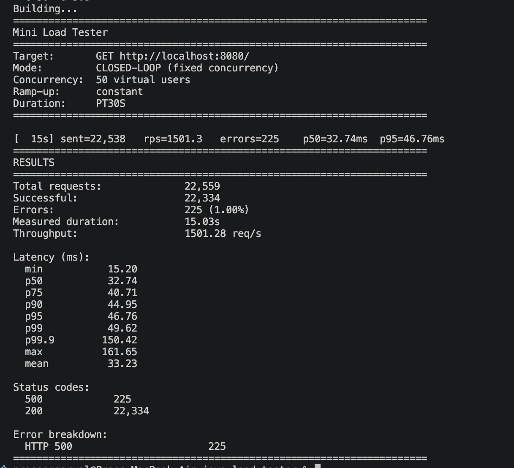

# Mini Load Tester

A Java 17 command-line tool for exploring HTTP load testing. It supports closed-loop and open-loop traffic, and has no third-party runtime dependencies. This is a local, portfolio-focused project—not a hosted service.

## Get started

You need JDK 17 or newer and Maven. To try the tool against the included demo server:

1. Build the project:

   ```bash
   mvn package
   ```

2. Start the demo server in one terminal:

   ```bash
   java -cp target/classes com.loadtester.testserver.DemoTargetServer \
     --port 8080 --latency-ms 30 --jitter-ms 15 --error-rate 0.01
   ```

3. In another terminal, run a 30-second test with 20 virtual users:

   ```bash
   java -jar target/mini-load-tester.jar \
     --url http://localhost:8080/ -c 20 -d 30s
   ```

The report is printed when the test finishes. Use `--output results.json` or `--output results.csv` to save it to a file.

## Build and run

There are two ways to build and run the load tester:

### 1. Run with the convenience script

`run.sh` builds the project with Maven, then runs the load tester with the arguments you provide:

```bash
./run.sh --url http://localhost:8080/ -c 20 -d 30s
```

The script rebuilds the project each time you run it.

### 2. Build once, then run the JAR

Build the executable JAR:

```bash
mvn package
```

Then run it as many times as needed:

```bash
java -jar target/mini-load-tester.jar \
  --url http://localhost:8080/ -c 20 -d 30s
```

Run the test suite with `mvn test`.

## Choose a load model

The load model is selected by whether you provide `-r`:

- **Closed-loop** (no `-r`): `-c` sets the number of virtual users. Each user waits for a response before sending another request. For example, run 50 virtual users for one minute:

  ```bash
  ./run.sh --url http://localhost:8080/ -c 50 -d 1m
  ```

- **Open-loop** (include `-r`): `-r` sets the target requests per second, and `-c` caps the number of in-flight requests. Arrivals are skipped, not queued, when the cap is full. For example, target 200 requests per second for two minutes, with at most 500 requests in flight:

  ```bash
  ./run.sh --url http://localhost:8080/ -r 200 -c 500 -d 2m
  ```

For either model, ramp-up controls how the load increases. This example ramps to 300 requests per second over 30 seconds, then holds that target for the rest of the test:

```bash
./run.sh --url http://localhost:8080/ -r 300 -c 1000 -d 3m \
  --ramp-up linear:0:30
```

No new requests start after the measurement deadline. Requests already in flight can finish (subject to the request timeout) before the final report. In open-loop mode, arrivals skipped because the scheduler falls behind are reported separately from arrivals skipped because the in-flight cap is full.

## Send a custom request

By default, the tool sends a `GET` request. For an endpoint that needs authentication, add a header; repeat `--header` to send more than one:

```bash
./run.sh --url https://api.example.com/health \
  --header "Authorization: Bearer YOUR_TOKEN" \
  -r 50 -c 100 -d 1m
```

To send JSON, choose a method, provide the body (inline or from a file), and set its content type:

```bash
./run.sh --url https://api.example.com/orders \
  --method POST --content-type application/json \
  --body-file examples/sample-body.json -c 10 -d 30s
```

To save the results, add an output path with a `.json` or `.csv` extension:

```bash
./run.sh --url http://localhost:8080/ -c 20 -d 30s \
  --output results.csv
```

The report includes request counts, errors, throughput, status codes, and latency percentiles. CSV exports include a compact `statusCodes` column (for example, `200=98;500=2`); `no_response` represents requests without an HTTP response.

## Options

| Option | What it does | Example |
| --- | --- | --- |
| `--url URL` | Target HTTP(S) endpoint (required) | `--url http://localhost:8080/` |
| `--method METHOD` | HTTP method; defaults to `GET` | `--method POST` |
| `-c, --concurrency N` | Virtual users in closed-loop mode or max in-flight requests in open-loop mode; closed-loop maximum is 10,000 | `-c 50` |
| `-r, --rate N` | Target requests per second; enables open-loop mode | `-r 200` |
| `-d, --duration TIME` | Measurement duration, such as `30s` or `2m` | `-d 30s` |
| `--warmup TIME` | Warm up before measurement; excluded from results | `--warmup 5s` |
| `--ramp-up SPEC` | Ramp-up pattern: `constant`, `linear`, `step`, or `spike` | `--ramp-up linear:0:30` |
| `--timeout TIME` | Maximum time to wait for each request | `--timeout 5s` |
| `--think-time TIME` | Delay between requests from each virtual user (closed-loop only) | `--think-time 100ms` |
| `--header "Key: Value"` | Add a request header; repeat to add more | `--header "X-Env: staging"` |
| `--body TEXT` / `--body-file PATH` | Send a request body inline or read it from a file; use one, not both | `--body-file examples/sample-body.json` |
| `--content-type TYPE` | Set the `Content-Type` header | `--content-type application/json` |
| `--output PATH` | Write a report; format comes from `.json` or `.csv` extension | `--output results.json` |
| `--help` | Show all options, defaults, and ramp-up syntax | `java -jar target/mini-load-tester.jar --help` |


