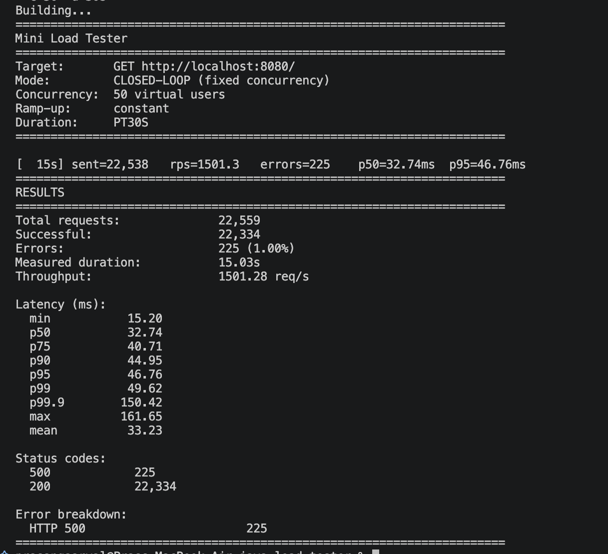

# Mini Load Tester

Mini Load Tester is a small Java CLI for generating HTTP load against a target endpoint.
It is useful for quick performance checks, simple benchmarking, and comparing how a service behaves under different traffic patterns.

## What it does

The tool can:

- send HTTP requests to any URL using GET, POST, PUT, DELETE, PATCH, or HEAD
- run in either closed-loop mode (fixed concurrency) or open-loop mode (fixed request rate)
- apply ramp-up patterns such as constant, linear, step, and spike load
- warm up the target before collecting results
- send headers and request bodies
- export results as JSON or CSV for later analysis

## Quick start

Build the project:

```bash
mvn clean package
```

Run a basic test against any HTTP endpoint:

```bash
java -jar target/mini-load-tester.jar --url https://example.com/health -c 50 -d 30s
```

Or use the helper script:

```bash
./run.sh --url https://example.com/health -c 50 -d 30s
```

## Choosing a load model

Use the mode that matches the question you want to answer:

- Closed-loop mode: good for asking, “How does the service behave with $N$ concurrent users?”
- Open-loop mode: better for asking, “What does latency look like if I sustain $X$ requests per second?”

Open-loop mode is usually the better choice for tail-latency and saturation analysis because it keeps sending requests on a schedule even when the target slows down.

## Common options

```bash
--url URL                 Target URL
--method METHOD           HTTP verb: GET, POST, PUT, DELETE, PATCH, HEAD
--concurrency, -c N       Virtual users or max in-flight requests
--rate, -r N              Target requests/second
--duration, -d DURATION   Test duration, e.g. 30s, 5m
--warmup DURATION         Warmup period excluded from results
--ramp-up SPEC            constant, linear, step, or spike
--header "Key: Value"     Repeatable request header
--body TEXT               Raw request body
--body-file PATH          Read request body from a file
--content-type TYPE       Shortcut for setting Content-Type
--output PATH             Write results to JSON or CSV
```

## Example: sending a JSON request

```bash
java -jar target/mini-load-tester.jar \
  --url https://api.example.com/orders \
  --method POST \
  --content-type application/json \
  --body-file examples/sample-body.json \
  -r 100 -c 200 -d 2m \
  --output results.json
```

## Demo server

A built-in demo target is included for local experimentation:

```bash
java -cp target/classes com.loadtester.testserver.DemoTargetServer \
  --port 8080 --latency-ms 30 --jitter-ms 15 --error-rate 0.01
```

Then run the load tester against `http://localhost:8080/`.

## What the output includes

The tool reports basic performance metrics such as:

- total requests sent
- success and error counts
- throughput
- latency percentiles like p50, p90, p95, p99, and p99.9

## Project layout

```text
src/main/java/com/loadtester/
  Main.java          CLI entry point
  cli/               argument parsing
  config/            test configuration
  engine/            load generation and ramp-up logic
  http/              request execution
  metrics/           latency and result aggregation
  report/            console and file reporting
  testserver/        demo HTTP target
```

## Tests

```bash
mvn test
```

## Screenshot


